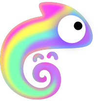

# Mable

Mable turns the HTML games your AI makes into a link anyone can play. Connect Mable to the AI tool you already use, then just say "publish my game". Your AI checks the game on a phone-sized screen, publishes it with your confirmation, and later shows you how your games are played.

Website: <https://mable.gg/mcp> · Support: <https://mable.gg/support> · Privacy: <https://mable.gg/privacy> · Terms: <https://mable.gg/terms>

## What this plugin contains

This plugin only connects your AI tool to Mable's hosted MCP server. It ships no code that runs on your machine: no scripts, hooks or local servers.

| Client | Server it connects to | Tools |
| --- | --- | --- |
| Claude, Claude Code | `https://studio.mable.gg/mcp/games` | Game publishing tools (below) |
| Cursor | `https://studio.mable.gg/mcp` | Game publishing tools plus Mable's game asset tools |

## Install

You sign in once in your browser with your Mable account (or create one). No API key is needed.

- **Claude Code**: install this plugin with `/plugin install mable --marketplace Upgrade-Intelligence/mable-plugin`, or add the server directly with `claude mcp add --transport http mable https://studio.mable.gg/mcp/games`. Then run `/mcp`, choose **mable** and sign in.
- **Claude (web, desktop, mobile)**: Settings → Connectors → add Mable from the directory, or add a custom connector with `https://studio.mable.gg/mcp/games`.
- **Cursor**: open <https://mable.gg/mcp> and choose **Add to Cursor**, or install this plugin from the Cursor Marketplace.
- **Codex**: `codex mcp add mable --url https://studio.mable.gg/mcp`, then `codex mcp login mable`.

## What you can ask

- "Make a phone game where you tap bubbles for 30 seconds, then publish it on Mable."
- "Publish this game as a link for my friends only, not public."
- "Save this as a draft first so I can try it on my phone."
- "Add a countdown and publish the new version." / "Go back to the previous version."
- "How many people played my game this week?"

Publishing always happens in two steps: the first call only playtests the game and returns a summary; the game goes live only after you have seen the summary and agreed.

## Tools

| Tool | What it does |
| --- | --- |
| `start_here` | Overview of the publish flow, your credit balance and recent games |
| `get_platform_rules` | Rules a game must follow on phone (portrait, touch) or desktop (keyboard, mouse) |
| `create_upload` | One-time upload link for a game folder |
| `check_game` | Free playtest: is it playable, what is broken and how to fix it. Publishes nothing |
| `publish_game` | Publishes a game and returns a playable link (two steps, see above) |
| `list_games` / `get_game_stats` | Your games, and players, 30-second plays, returning players and play time |
| `set_game_visibility` / `unpublish_game` | Public, link-only, or offline |
| `create_game` / `save_draft` / `get_game` | Private drafts that players do not see until you publish |
| `list_versions` / `restore_version` / `get_publish_status` | Version history with who made each change, restore, and current status |
| `read_game_file` / `search_game_files` / `edit_game_files` | Read and edit a game's code on Mable when your AI has no local files |

The Cursor connection also includes Mable's asset tools (sprite animation, visual effects, sound effects, music, voice and 3D models). Those consume Mable credits; the game tools above are free.

## Repository layout

- `.claude-plugin/` and `.mcp.json`: the Claude and Claude Code plugin (game publishing tools).
- `.cursor-plugin/` and `mcp.json`: the Cursor plugin (all Mable tools).
- `openai/`: the ChatGPT and Codex plugin package. Zip the contents of this folder (so `plugin.json` is at the root of the archive) to upload it.

## Data and privacy

- **What is sent to Mable**: the game files you ask your AI to check or publish, the title and description you give it, and the requests your AI makes to the tools above. Mable does not request or receive your conversation history.
- **Where it goes**: Mable's own servers at `studio.mable.gg`. Published games are hosted on `mable.gg`.
- **Your account**: sign-in uses OAuth in your browser; your AI tool receives an access token, never your password. You can disconnect at any time by removing the Mable server from your AI tool.
- Full details: <https://mable.gg/privacy>.

## Support

- Help center: <https://mable.gg/support>
- Email: <contact@mable.gg>
- Community: [Mable Discord](https://discord.gg/2HQN4XrgmP)

## License

MIT, see [LICENSE](LICENSE).
